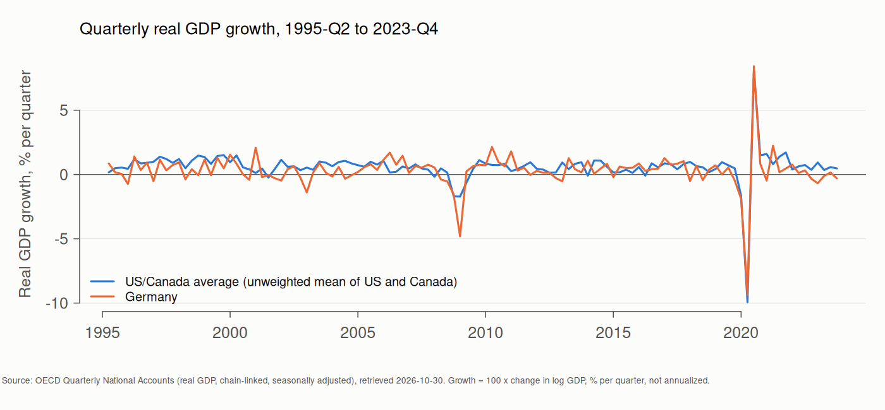
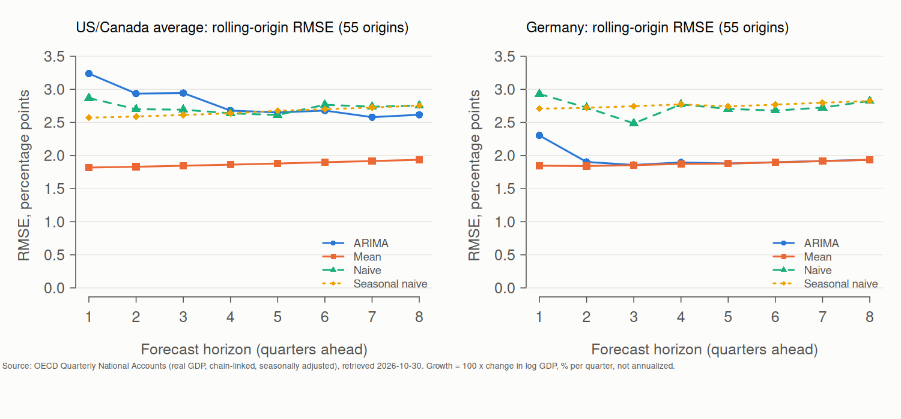
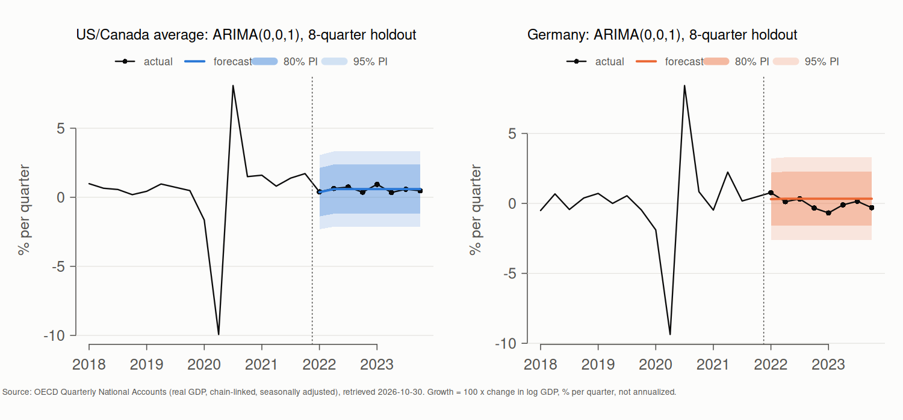

# Quarterly GDP growth: US/Canada average vs Germany

*Generated by `gdp/build_report.R` on 2026-10-30 (UTC) from the outputs of `gdp/comparative_gdp_analysis.R` and `gdp/rolling_origin_evaluation.R`. OECD data retrieved 2026-10-30 22:46:44 UTC. R version 4.5.3 (2026-03-11), forecast 9.0.2, tseries 0.10.63, FinTS 0.4.9, rugarch 1.5.6.*

> This report supersedes the original course report ([archive/](../archive/README.md)). Several of the original's headline numbers can't be reproduced from the data source it describes; see *Relation to the original report* below.

## Summary

- From 1995-Q2 to 2023-Q4, quarterly real GDP growth averaged **0.591%** for the US/Canada average and **0.312%** for Germany. The 0.279 pp difference isn't statistically significant (Welch 95% CI -0.083 to 0.641, p = 0.13).
- In chronological rolling-origin evaluation (55 forecast origins, horizons 1 to 8), the best model by RMSE is **Mean** for the US/Canada average and **Mean** for Germany. ARIMA's pooled RMSE is 1.50 times the historical mean's for the US/Canada average, and 1.04 times for Germany.
- Prediction intervals: pooled over horizons, nominal 80% intervals covered 86%–92% of outcomes and nominal 95% intervals 89%–94%. They're too wide in the middle and too narrow in the tails, the pattern expected when normal intervals meet fat-tailed errors (2008–09, 2020).

## Data and definitions

| Item | Definition |
|---|---|
| Source | OECD Quarterly National Accounts, dataflow `DSD_NAMAIN1@DF_QNA` v1.1: real GDP (B1GQ), chain-linked volume, national currency, calendar and seasonally adjusted. Query in `data/comparative_gdp_oecd.SOURCE.txt` |
| Countries | United States (USA), Canada (CAN), Germany (DEU) |
| Window | 1995-Q1 to 2023-Q4 levels, giving 115 quarterly growth observations (1995-Q2 to 2023-Q4) |
| Target | 100 × [log(GDP_t) − log(GDP_t−1)], **percent per quarter, not annualized**. Forecast errors are in percentage points of quarterly growth |
| US/Canada average | The **unweighted mean of the US and Canadian growth rates**, quarter by quarter. It is *not* an official North American aggregate: US GDP is more than ten times Canada's, so a GDP-weighted aggregate would track the US much more closely. It's kept because it's the construction the original analysis used |
| Germany | Germany alone. The original report used it as a proxy for Europe, and this OECD dataflow has no euro-area or EU aggregate for the series definition used here. Results describe Germany, not Europe |
| Revisions | National accounts are revised. These are the values as published on 2026-10-30 |

### Descriptive statistics, % per quarter

| Series | Mean | SD | Min | Max |
|---|---|---|---|---|
| US/Canada average | 0.591 | 1.333 | -9.929 | 8.085 |
| Germany | 0.312 | 1.453 | -9.366 | 8.424 |

The 2008–09 recession and the 2020 pandemic quarters dominate the extremes and much of the variance.

## Forecast evaluation

### Rolling origin (the main result)

Every quarter from the 60th observation on is a forecast origin. Each model is refitted on the data up to that origin only (expanding window), forecasts 1–8 quarters ahead, and is scored against what happened. That gives 55 origins and 412 forecasts per model and series. `auto.arima` re-selects its order at every origin. The baselines are naive (last value), seasonal naive (value four quarters earlier) and mean (average of all data so far).

| Series | Model | Forecasts | RMSE | MAE | 80% PI coverage | 95% PI coverage |
|---|---|---|---|---|---|---|
| US/Canada average | Mean | 412 | 1.872 | 0.696 | 0.90 | 0.94 |
| US/Canada average | Seasonal naive | 412 | 2.656 | 1.239 | 0.86 | 0.89 |
| US/Canada average | Naive | 412 | 2.723 | 1.175 | 0.88 | 0.91 |
| US/Canada average | ARIMA | 412 | 2.807 | 0.995 | 0.87 | 0.91 |
| Germany | Mean | 412 | 1.879 | 0.812 | 0.92 | 0.93 |
| Germany | ARIMA | 412 | 1.956 | 0.842 | 0.91 | 0.93 |
| Germany | Naive | 412 | 2.733 | 1.356 | 0.91 | 0.94 |
| Germany | Seasonal naive | 412 | 2.758 | 1.427 | 0.88 | 0.91 |

RMSE relative to the naive forecast at selected horizons (below 1 = better than naive):

| Series | Model | h = 1 | h = 4 | h = 8 |
|---|---|---|---|---|
| US/Canada average | ARIMA | 1.129 | 1.015 | 0.950 |
| US/Canada average | Mean | 0.634 | 0.706 | 0.703 |
| Germany | ARIMA | 0.786 | 0.684 | 0.685 |
| Germany | Mean | 0.630 | 0.676 | 0.685 |

**Why the mean beats ARIMA.** Quarter-over-quarter growth has little predictable short-run dynamics beyond its average. ARIMA adds estimated short-run dynamics that don't carry over out of sample, and after 2020 every training window contains the pandemic outliers, which distort the fitted dynamics. For the US/Canada average one quarter ahead, ARIMA's RMSE is 1.129 times the naive forecast's, against 0.634 for the mean. This is a real result, not a failure of the evaluation: a forecaster that can't beat the historical mean here shouldn't be preferred over it.

**Revised data vs real-time forecasting.** This backtest uses today's revised GDP series at every origin. A forecaster at that origin would have seen an earlier vintage, often with materially different recent quarters, because first releases are revised for years. So these errors are *pseudo-out-of-sample*: they measure how well each model extrapolates the final data, and they likely understate real-time errors, especially at short horizons. A real-time evaluation would rebuild each origin from that date's data vintage, for example from the OECD's archive of original releases and revisions, or ALFRED for US data. That isn't done here.

### Single 8-quarter holdout

The last 8 quarters (2022-Q1 to 2023-Q4) are held out. ARIMA orders chosen on the training data: US/Canada average ARIMA(0,0,1), Germany ARIMA(0,0,1).

| Series | Model | In-sample RMSE | Test RMSE | Test MAE |
|---|---|---|---|---|
| US/Canada average | ARIMA | 1.356 | 0.183 | 0.145 |
| US/Canada average | Naive | 2.096 | 1.171 | 1.154 |
| US/Canada average | Seasonal naive | 1.961 | 0.905 | 0.817 |
| US/Canada average | Mean | 1.375 | 0.197 | 0.168 |
| Germany | ARIMA | 1.470 | 0.545 | 0.454 |
| Germany | Naive | 2.291 | 0.635 | 0.551 |
| Germany | Seasonal naive | 2.204 | 1.265 | 0.956 |
| Germany | Mean | 1.493 | 0.542 | 0.451 |

ARIMA's test errors are *lower* than its in-sample fit only because the holdout window was calm compared with a training period that includes 2008–09 and 2020. One 8-quarter window is a small sample; the rolling-origin results above are the more reliable measure.

### Forecast beyond the sample

Final models refitted on all data: US/Canada average ARIMA(0,0,1), Germany ARIMA(0,0,1).

| Series | First quarter | Point | 80% PI | 95% PI | Point at h = 8 |
|---|---|---|---|---|---|
| US/Canada average | 2024-Q1 | 0.615 | -1.078 to 2.307 | -1.974 to 3.203 | 0.592 |
| Germany | 2024-Q1 | 0.426 | -1.418 to 2.270 | -2.394 to 3.246 | 0.312 |

These forecasts can now be checked against published 2024–25 data by extending `END` in `gdp/fetch_oecd_gdp.R`.

## Diagnostics

| Series | ADF p | Ljung-Box p (lag 8) | ARCH-LM p (lag 8) |
|---|---|---|---|
| US/Canada average | 0.010 | 0.998 | 0.427 |
| Germany | 0.010 | 0.843 | 0.097 |

GARCH(1,1) with an ARMA(1,1) mean, full sample:

| Series | alpha1 | beta1 |
|---|---|---|
| US/Canada average | 0.999 | 0.000 |
| Germany | 0.000 | 0.999 |

Some estimates sit at the edge of the parameter space (alpha or beta near 0 or 1). That suggests a few extreme quarters, chiefly 2020, drive the fit, and the volatility dynamics aren't well identified from this sample.

## Regional comparison

Difference in mean growth (US/Canada average − Germany): 0.279 pp, Welch 95% CI -0.083 to 0.641, p = 0.131. Variance ratio: 0.84 (F-test p = 0.359). Both tests assume independent observations; growth rates are serially correlated, so these p-values are optimistic.

## Relation to the original report

The original report (`archive/comparative_gdp_final_report.pdf`, kept unchanged) describes the same transformation and data source. Applying them gives different headline numbers:

| Quantity | Original report (PDF) | This analysis |
|---|---|---|
| Mean growth, % per quarter (US/Canada avg / Germany) | 4.48 / 0.76 | 0.591 / 0.312 |
| Standard deviation (US/Canada avg / Germany) | 0.67 / 0.47 | 1.333 / 1.453 |
| Difference in mean growth | about 3.9 pp, "persistent" | 0.279 pp, 95% CI -0.083 to 0.641, p = 0.131 |
| ARIMA order selected (full sample) | (1,0,1) for both | (0,0,1) / (0,0,1) |
| Ljung-Box p (US/Canada avg / Germany) | 0.264 / 0.441 | 0.998 / 0.843 |
| ARCH-LM p (US/Canada avg / Germany) | 0.892 / 0.135 | 0.427 / 0.097 |
| Long-run forecast (US/Canada avg / Germany) | about 4.63 / 0.73 | 0.592 / 0.312 |

**What can and can't be established.** Average quarter-over-quarter growth of US and Canadian real GDP is well under 1% per quarter in any published vintage, so a mean of 4.48% per quarter (about 19% a year) can't come from the transformation the report describes. The most likely explanations are a differently defined input, such as already-transformed or annualized growth rates, nominal values, or a series on a different basis, or a processing error. The original input file wasn't kept, so the cause **can't be confirmed**. Germany's original mean (0.76% per quarter, about 3% a year) is also well above what Germany's real GDP grew over this window, which points to the same kind of input problem. Data revisions shift long-run averages by far less than these gaps.

The report's methods carry over: the growth transformation, decomposition, ARIMA, residual and ARCH diagnostics, and GARCH. Its conclusions do not. There's no evidence here of a large or persistent growth gap, the selected models are simpler, and the US/Canada average is not more volatile than Germany (variance ratio 0.84), contrary to the original.

## Limitations

- The US/Canada average is unweighted, and Germany isn't Europe. A GDP-weighted North American series and a euro-area aggregate (from Eurostat) would answer the original regional question more directly.
- 2008–09 and 2020 are structural breaks. A run that excludes or models the pandemic quarters would likely change the GARCH and interval results most.
- Normal prediction intervals don't fit the fat-tailed errors. Bootstrap or Student-t intervals are worth comparing.
- The evaluation uses revised data, not real-time vintages (see above).

